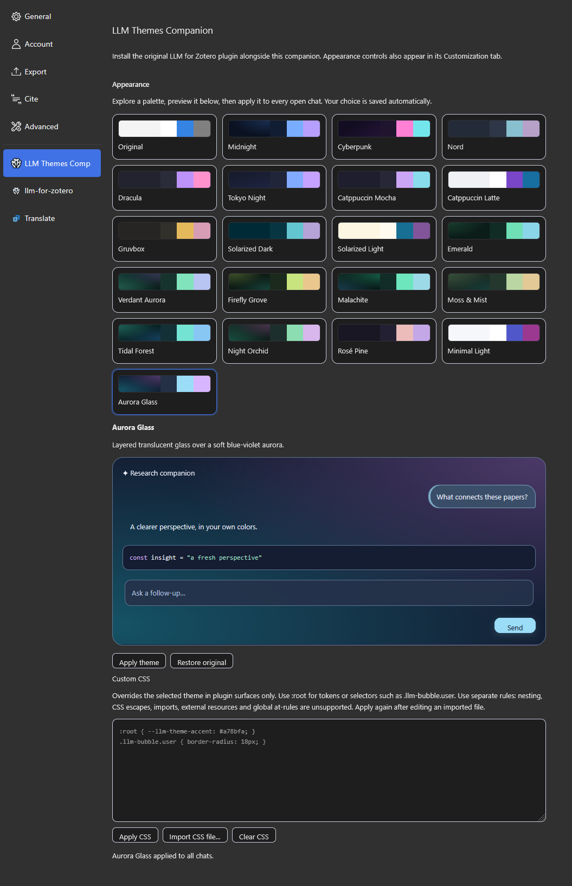

# LLM for Zotero — Themes Companion



Give [LLM for Zotero](https://github.com/yilewang/llm-for-zotero) a new look with
20 themes, live previews, and custom CSS—without modifying the original plugin.

**This project is 100% vibecoded.** Its code, themes, and documentation were
created with AI coding agents, guided by human requests, testing, and feedback.

## Features

- **20+ themes**, plus an Original option that follows Zotero's appearance.
- **Visual theme gallery** with previews before applying a selection.
- **Live switching** across open chat surfaces, with your selection saved across restarts.
- **Custom CSS editor and file import**, applied without rebuilding the add-on.
- **Scoped styling** for the plugin's sidebar, standalone chat, dialogs, and menus.
- **Independent installation**: the original plugin keeps its own add-on ID, settings, and updates.

Disabling the companion removes its styling and injected controls. Re-enabling
it restores your saved appearance preferences.

## Themes

Midnight · Cyberpunk · Nord · Dracula · Tokyo Night · Catppuccin Mocha ·
Catppuccin Latte · Gruvbox · Solarized Dark · Solarized Light · Emerald ·
Rosé Pine · Minimal Light · Aurora Glass · Verdant Aurora · Firefly Grove ·
Malachite · Moss & Mist · Tidal Forest · Night Orchid

The six new dark green palettes explore emerald-to-turquoise auroras, firefly
gold, polished jade, misty sage, coastal teal, and green-to-orchid twilight.
Each uses layered gradient fades with coordinated controls and syntax colors.

Each palette includes coordinated surfaces, text, controls, focus states,
borders, shadows, and syntax colors. Aurora Glass uses translucent surfaces and
gradients, with blur where it does not interfere with dropdown positioning.

## Installation

You need **both** the original LLM for Zotero plugin and this companion.

1. Install the original plugin from its
   [upstream releases](https://github.com/yilewang/llm-for-zotero/releases).
2. Download the companion `.xpi` from this repository's [**Releases** page](https://github.com/A1exHorst/llm-for-zotero-themes-companion/releases),
   or build it from source using the instructions below.
3. In Zotero, open **Tools → Plugins → gear icon → Install Plugin From File**
   and select the companion `.xpi`. Restart Zotero.

## Usage

Open **LLM for Zotero → Customization → Appearance**, or the separate **LLM Themes Companion** settings pane to configure the Theme.

### Choose a theme

Select a card to preview its palette, then click **Apply theme** to update open
chats. **Restore original** returns to Zotero's original theme; custom CSS can
be removed separately with **Clear CSS**.

### Add custom CSS

Enter CSS in the editor and click **Apply CSS**. Custom rules override the
selected theme and are confined to plugin-owned surfaces.

Use `:root` for theme tokens and ordinary selectors for plugin components:

```css
:root {
  --llm-theme-accent: #a78bfa;
}

.llm-bubble.user {
  border-radius: 18px;
}
```

**Import CSS file…** copies a `.css` file into the editor. Review it and click
**Apply CSS** to save it. Files are not watched automatically; re-import after
editing an external file.

The editor supports ordinary style rules, CSS variables, `@media`, and
`@supports`. Imports, external resources, global at-rules, nested CSS, and CSS
escape sequences are unsupported. Custom CSS is limited to 100,000 characters.

## Compatibility and testing

Verified with **Zotero 10.0.6 on Windows** and **LLM for Zotero 3.9.12**.

Validation includes 19 custom CSS compiler tests and eight native Zotero
integration tests against the unmodified original plugin. These cover theme
rendering, model and reasoning selection under Aurora Glass, native settings
card layout, CSS overrides and file import, new windows, and disable/re-enable
cleanup. See [TESTING.md](TESTING.md) for details.

The companion observes the original plugin's interface rather than patching its
functions. Major upstream UI changes may require compatibility updates.

Automatic updates are not configured for this distribution. Install newer
companion XPI versions manually; the original plugin retains its own update
mechanism.

## Build from source

Use Node.js 22 or newer with npm.

```sh
npm ci
npm run typecheck
npm test
npm run build
```

The installable add-on is written to
`build/llm-for-zotero-themes-companion-1.1.0.xpi`.

### Run native Zotero tests

Set `ZOTERO_PLUGIN_ZOTERO_BIN_PATH` to your Zotero executable, then run:

```sh
npm run test:zotero
```

The runner checks out upstream revision
`435dd1928949ddb9361c2039da3d1ac96034c300` into `.test-upstream`, installs its
locked development dependencies, and launches an isolated scaffold profile.
Tests use fixture papers and mocked model catalogs; no paid model calls occur.
To use a prepared clean source checkout instead, set `LLM_THEME_UPSTREAM_PATH`.

Before publishing automatic updates, replace the reserved `.invalid` update URL
in `addon/manifest.json` with an HTTPS update manifest that you control.

## Feedback and contributions

Bug reports, theme refinements, and compatibility fixes are welcome. For UI
issues, include your Zotero version, original plugin version, companion version,
selected theme, and a screenshot when useful.

## License and credits

Licensed under [AGPL-3.0-or-later](LICENSE).

Built for [yilewang/llm-for-zotero](https://github.com/yilewang/llm-for-zotero).
The theme and CSS tooling originated in work on a themed fork of that project;
this companion is a separate add-on and leaves the original plugin unchanged.
